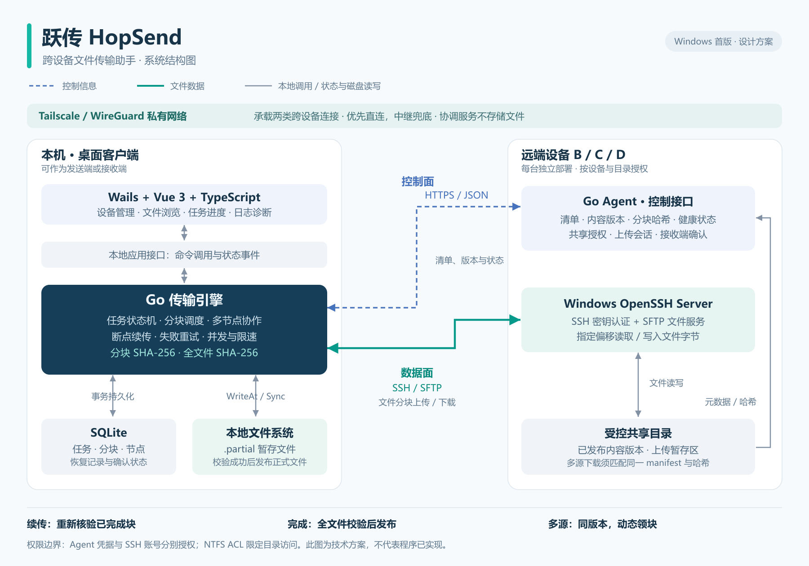

# 架构与依赖边界



## 1. 系统边界

- UI：Wails/Vue 负责操作和展示。
- 引擎：任务、分块、续传、调度、校验和发布。
- Agent：HTTPS 控制接口、清单、可用性、上传确认。
- OpenSSH/SFTP：文件字节的偏移读写。
- Tailscale：私有网络连接，优先直连、中继兜底。
- SQLite 与文件系统：任务状态和文件内容，分别持久化。

## 2. 依赖方向

```text
apps/* → internal/app → engine / scheduler / manifest / domain
apps/agent → internal/agent/* → 用例与领域能力
具体适配器 → 内核定义的接口：sftp、sqlite、filesystem、nodeclient、tailscale
apps/desktop/bridge → app；frontend/services → Wails 绑定
domain → Go 标准库中的基础类型，不依赖外部服务
```

接口由使用它的内核组件定义，适配器实现。入口负责装配，避免引擎直接初始化 SSH、SQLite 或 Windows 服务。
不创建承接任意内容的 common/utils 包；无法明确归属时先检查职责边界。

## 3. 首批能力接口

| 能力 | 建议归属 | 说明 |
|---|---|---|
| TaskRepository / ChunkRepository | engine 或 app 的消费侧 | 任务和块事务 |
| RangeReader / RangeWriter | transport | context、偏移、长度与能力声明 |
| ManifestProvider | manifest/消费侧 | 返回受信任内容版本 |
| NodeControlClient | nodeclient 对外能力 | Agent 会话和可用性 |
| StagingFile / Publisher | filesystem 对外能力 | 写入、同步、校验和同卷发布 |
| NetworkProbe | network 对外能力 | 分层诊断及观察时间 |
| EventSink | app 对外能力 | UI 无关的聚合事件 |

以上名称为设计建议，接口应在最小实现时按调用方需要收敛，不为预想功能一次生成大接口。

## 4. 正确性约束

下载：可信 manifest → 范围读 → 暂存写入并哈希 → 块校验 → 文件 Sync → SQLite 确认状态 → 全文件哈希 → 同卷重命名 → 完成。

恢复：读取原版本、校验磁盘上已记录块，缺失或损坏块重新排队。块重新分配前停止旧写入者，不能只禁止旧数据库提交。

上传：服务端创建受控会话，SFTP 写暂存，接收 Agent 验证并 finalize；以服务端已确认状态恢复，不仅凭客户端发送字节数判断。

多源：同一 manifest 和块哈希；快节点动态多领块；限制全局/节点/连接/请求流水线及内存预算。

## 5. 权限约束

Agent API 凭据不替代 SSH 账号权限。专用账号与 NTFS ACL 限定共享/暂存目录，主机密钥和 HTTPS 证书必须验证。
清单路径相对于授权根；拒绝路径越界，识别符号链接/reparse point，默认不跨根目录。
Tailscale 控制服务不存储内容；Agent 不是数据中继。文件传输可以经中继网络路径，但不要求上传到应用中心服务器。
